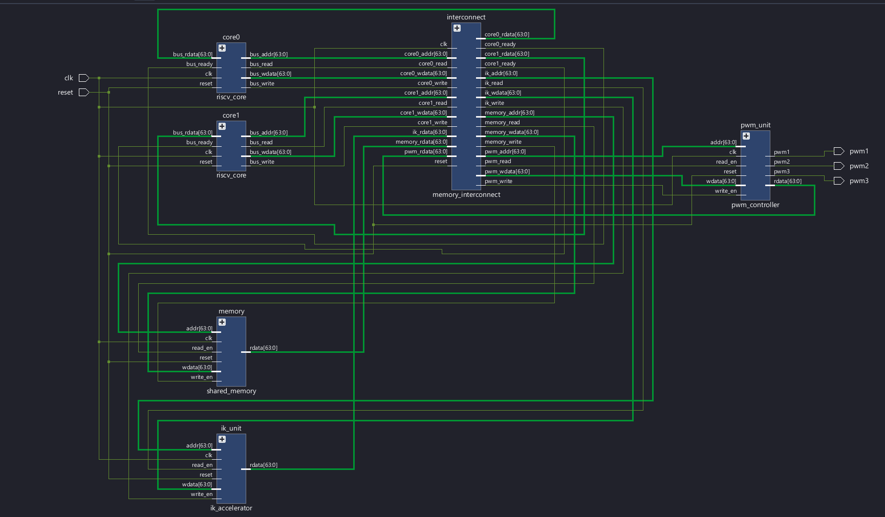
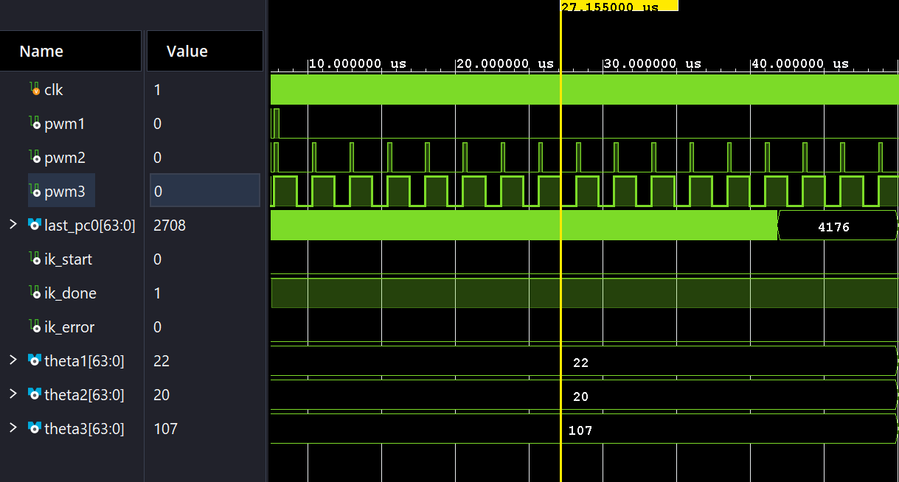

# Dual-Core RISC-V Processor for 3D Robotic Arm Control

## Overview
This project focuses on a dual-core RISC-V processor design for 3D robotic arm control using Verilog HDL. It combines FSM-based multi-cycle execution, inverse kinematics, and PWM motor control to support robotic arm movement.

## Objectives
- Design a dual-core RISC-V processor using Verilog HDL.
- Implement FSM-based multi-cycle execution.
- Calculate robotic arm joint angles using X, Y, and Z coordinates.
- Integrate PWM-based motor control.
- Simulate and analyze RTL behavior using AMD Vivado.

## Key Features
- Dual-core RISC-V processor architecture
- FSM-based multi-cycle execution
- X, Y, and Z coordinate-based inverse kinematics
- Joint-angle calculation for robotic arm control
- PWM motor-control logic
- RTL simulation and waveform analysis

## Tools and Technologies
- **HDL:** Verilog
- **Simulation Tool:** AMD Vivado
- **Architecture:** RISC-V
- **Concepts:** RTL Design, FSM, Inverse Kinematics, PWM

## Repository Structure

```text
Dual-Core-RISC-V-Robotic-Arm/
├── sim_1/
│   └── new/
│       └── tb_dual_core_robot.v
├── sources_1/
│   └── new/
├── Block Diagram.jpg
├── Schematic.png
├── Waveform.png
└── README.md
```

## Project Visualizations

### Block Diagram


### Schematic


### Simulation Waveform


## Simulation and Verification
The project includes a Verilog testbench named `tb_dual_core_robot.v` for simulating the design. AMD Vivado is used to inspect RTL behavior and waveforms.

Simulation results should be evaluated against the expected behavior of the implemented modules.

## Applications
- RISC-V processor design and learning
- Digital system and RTL design practice
- FPGA-based robotic control research
- Hardware architecture experimentation

## Future Enhancements
- Integrate the design with physical robotic arm hardware.
- Expand testbench coverage and verification.
- Improve coordination between processor cores.
- Evaluate joint-angle calculations and motor-control performance on hardware.

## Author
**Ponnitivalasa Manikantha**

B.Tech – Electronics and Communication Engineering (VLSI)  
GIET University

**Areas of Interest:** RTL Design, Digital Verification, RISC-V Architecture, and VLSI Design.
